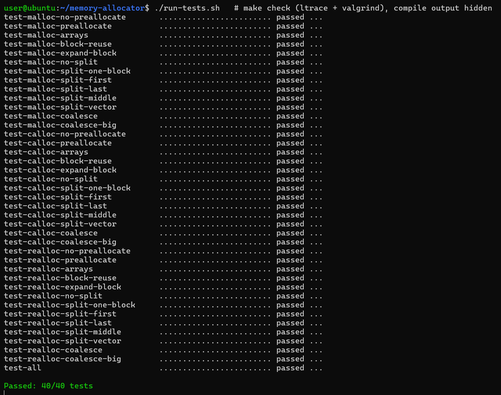
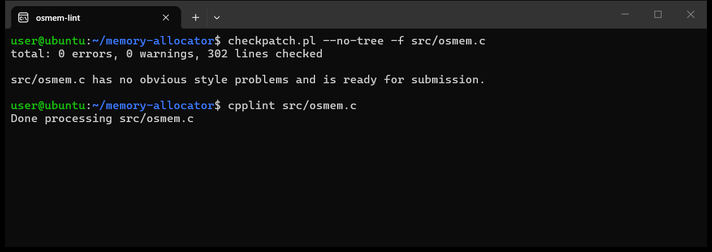

# Алокатор пам'яті

Власна реалізація `malloc`, `calloc`, `realloc` і `free` мовою C. Код зібрано в бібліотеку `libosmem.so`, функції називаються `os_malloc`, `os_calloc`, `os_realloc` і `os_free`.
Умова завдання: [open-education-hub/operating-systems](https://github.com/open-education-hub/operating-systems/tree/main/content/assignments/memory-allocator).

## Як працює

- **Малі блоки** беруться з купи через `sbrk`. При першому зверненні одразу резервується 128 КБ.
- **Великі блоки** виділяються через `mmap` і звільняються через `munmap`. Для `malloc` великим вважається блок від 128 КБ, для `calloc` — від розміру сторінки (4 КБ).
- **Повторне використання**: береться найкращий за розміром вільний блок (best fit). Зайве відрізається в новий вільний блок, а сусідні вільні блоки зливаються.
- **Вирівнювання**: усі адреси вирівняні на 8 байт.

Код: [src/osmem.c](src/osmem.c).

## Тести

Запуск (Linux або WSL; потрібні `gcc`, `make`, `ltrace`, `valgrind`, `python3`):

```bash
./run-tests.sh
```

Результат: **пройдено 40 з 40 тестів**. Тести перевіряють виклики `brk`/`mmap`/`munmap` (через `ltrace`) і витоки пам'яті (через Valgrind).



Стиль коду (`checkpatch.pl` і `cpplint` з конфігом курсу): помилок немає.


